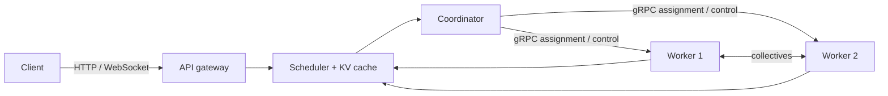

# Architecture and current boundaries

## Intended system

The project aims to demonstrate a coordinator assigning model tensor shards to workers, then coordinating distributed execution while an inference runtime schedules requests and manages per-request KV state. An API gateway is intended to stream token events to clients.

The diagram is the target architecture, not a claim that all paths are currently connected.

## Implemented review boundary

- `sharding.py` provides a small pure-Python row-major tensor representation, even contiguous splitting, shard validation/reconstruction, and simulated row/column parallel linear operations.
- `master.py` exposes local HTTP health, worker registration/listing, and cluster summary routes backed by an in-memory registry.
- `runtime.py` sketches FIFO iteration-level admission and token-slot cache accounting. It has no model runner or GPU memory allocator.
- `demo.py` and `row_parallel_demo.py` compare synthetic parallel-layout results against local reference computations.
- `website/` is a static project review page. Its animated flow is illustrative and has no connection to the coordinator.

## Interfaces and next implementation steps

Keep shared message shapes transport-independent in `protocol.py`. Define versioned gRPC messages for worker registration, health, shard assignment, and assignment acknowledgement before introducing RPC-generated code. A worker should validate model identity, tensor name, shape, dtype, shard axis, index, and count before loading data. Safetensors and PyTorch should remain optional runtime dependencies, and model weights should stay outside Git.

The scheduler needs explicit admission limits, cancellation, completion, and failure semantics before it is connected to model execution. KV allocation should state its block size, ownership, reclamation behavior, and memory accounting. Collective calls should be added only with an available distributed backend and a reproducible multi-process profile.

## Known limitations

The current coordinator is single-process and its registry is ephemeral. There is no gRPC transport, remote worker execution, model weight loader, tokenizer, real generation loop, continuous-batching integration, production KV cache, authentication, persistence, deployment manifests, or performance data. The demos establish layout behavior only; they do not establish network latency or inference throughput.
